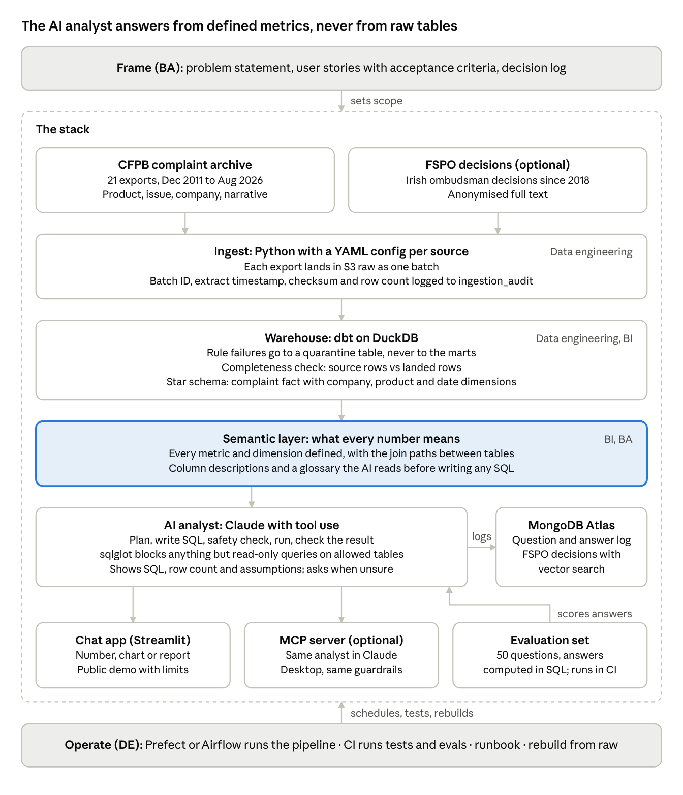

# QueryCF

A conversational AI analyst that turns plain-English questions into validated SQL, charts and auditable reports over 17.5M+ consumer finance complaints.

The AI part only works because of what sits underneath it: an audited complaints warehouse, and a semantic layer that defines every metric, so the analyst reads precise definitions instead of guessing from raw tables.

> **Status:** phases 0-2 are done. The CFPB archive is ingested, audited and modelled into a tested star schema; the semantic layer and AI analyst come next. See the [roadmap](#roadmap).



## Why

Regulated firms need answers they can audit. A plain-English answer is only useful if you can see how it was produced: which metric definition it used, which SQL ran, how many rows it read, and which batch of data those rows came from. QueryCF is built so that every answer traces back that far.

Framing documents:

- [Problem statement](docs/00-problem-statement.md)
- [Personas](docs/01-personas.md)
- [User stories with acceptance criteria](docs/02-user-stories.md)
- [Decision log](docs/03-decision-log.md)
- [Data profile of all 21 exports](docs/04-data-profile.md)
- [Warehouse design](docs/05-warehouse-design.md)

## Data

| Source | What it holds | How it's used |
| --- | --- | --- |
| [CFPB Consumer Complaint Database narratives archive](https://www.consumerfinance.gov/foia-requests/foia-electronic-reading-room/cfpb-consumer-complaint-database-narratives-archive/) | 17,533,918 US complaints received 1 Dec 2011 to 31 Aug 2026, in 21 zipped CSV exports (about 1.4 GB), with product, issue, company, company response and consumer narrative | Main dataset. Each export is replayed as a new batch, oldest first |
| FSPO decisions | Anonymised full text of the Irish Financial Services and Pensions Ombudsman's legally binding decisions since 2018 | Optional document layer, off until its terms of use are checked |

The CFPB stopped publishing complaint narratives in August 2026, so the archive is a fixed dataset. That also makes it a source of ground truth: any answer the analyst gives can be checked against a number computed directly in SQL.

**Complaint narratives are unverified consumer statements.** Answers describe what was reported, not what happened.

## Quick start

Needs Python 3.11 or later.

```bash
python -m venv .venv
.venv\Scripts\activate          # macOS or Linux: source .venv/bin/activate
pip install -r requirements.txt

python run_pipeline.py ingest --export CCDB_Export_21_August_2026.zip   # newest export, 10.5 MB
python run_pipeline.py ingest      # all 21 exports, about 1.4 GB
python run_pipeline.py load        # copy each landed batch into the warehouse
python run_pipeline.py transform   # dbt builds and tests the star schema
python run_pipeline.py status      # every ingestion attempt and batch load
pytest
```

`python run_pipeline.py all` runs ingest, load and transform in one go. Raw files land in `data/raw/`; the audit tables and the warehouse live in `data/warehouse/query_cf.duckdb`. To land raw files in S3 instead, configure AWS credentials and set `QUERY_CF_RAW=s3://your-bucket/raw`.

## How ingestion works

- **One config per source.** [`config/sources/cfpb.yaml`](config/sources/cfpb.yaml) lists the 21 exports oldest first and the 16 columns each should carry. Adding a source means adding a file there.
- **One batch per export.** Each export is downloaded while its SHA-256 is computed, profiled, and copied into `data/raw/<source>/<batch_id>/`. The batch ID comes from the checksum, so the same bytes can never land twice.
- **Every attempt is audited.** An attempt gets a row in `ingestion_audit` as soon as it starts, so even a crash leaves a trace:

  | Column | What it records |
  | --- | --- |
  | `attempt_id` | Sequence number of the attempt |
  | `source`, `export_name`, `source_uri` | What was fetched, and from where |
  | `status` | `running`, `landed`, `unchanged` or `failed` |
  | `batch_id`, `landed_uri` | The batch and where its file landed |
  | `sha256`, `byte_size` | Checksum and size of the export |
  | `row_count`, `column_count`, `columns_match` | Data rows (counted with a CSV parser, because narratives contain line breaks), columns, and whether they match the config |
  | `extract_ts` | When the CFPB extracted the file, from the zip |
  | `started_at_utc`, `finished_at_utc`, `error` | Timing, and the error if it failed |

- **Safe re-runs.** A landed export is skipped. `--force` fetches it again, and it lands as a new batch only if its bytes changed. A failed export is retried on the next run, and any failure makes the run exit non-zero.

## How the warehouse works

Every rule here comes from the [data profile](docs/04-data-profile.md); the [warehouse design](docs/05-warehouse-design.md) has the details.

- **Bronze.** `load` copies each export's current batch into `bronze.cfpb_complaints` as published text, tagged with its `batch_id`. A newer batch of an export replaces the old rows in one transaction.
- **Staging.** dbt types and trims every row: dates become dates, Yes/No becomes true/false, Tags become two flags, and State is checked against US postal codes.
- **Quarantine.** A row with an invalid ID or date, a missing product or company, or a repeated ID goes to `quality.quarantine_complaints` with the rule it broke, and never reaches the marts.
- **Flags.** Rows with smaller issues (a missing state or issue, a date sent before the date received) stay in the marts with a flag, so totals aren't understated. `quality.dq_summary` counts every rule and flag per batch.
- **Star schema.** `marts.fct_complaints` (one row per complaint, with its `batch_id`) joins to `dim_company`, `dim_product` and `dim_date`. Narratives live in `marts.complaint_narratives`. `dim_product.product_group` stays stable across the CFPB's 2017 and 2023 product renames.
- **Completeness.** For every batch, rows counted at ingestion must equal rows loaded, which must equal rows in the marts plus rows in quarantine. If not, the build fails and names the batch.

## Project layout

```text
query_cf/               pipeline package
  config.py             loads and validates config/sources/*.yaml
  ingest.py             fetch, checksum, profile and land each export
  audit.py              the ingestion_audit table in DuckDB
  storage.py            raw zone: local folder or S3
  load.py               copies landed batches into the bronze table
  transform.py          runs dbt build on the warehouse
config/sources/         one YAML file per source
warehouse/              dbt project: seeds, staging, quality and mart models, tests
scripts/                profile_exports.py: profiles every export before modelling
docs/                   framing, data profile, warehouse design, decision log
tests/                  pytest suite, run in CI
run_pipeline.py         one command to run the pipeline
```

## Roadmap

The MVP is phases 0-5, published at the MVP gate; phases 6-8 follow.

- [x] **0. Frame:** problem statement, two personas, 14 user stories with acceptance criteria, decision log
- [x] **1. Ingest:** YAML config per source; batch ID, extract timestamp, SHA-256 and row count in `ingestion_audit`; safe re-runs
- [x] **2. Warehouse:** dbt on DuckDB, with staging and mart models, data tests, a quarantine table, a completeness check and a star schema
- [ ] **3. Semantic layer:** every metric and dimension defined, with join paths, column descriptions and a glossary
- [ ] **4. AI analyst:** question → plan → SQL → sqlglot safety check → run → answer with SQL, row count and assumptions; every question logged
- [ ] **5. Evaluation:** 50 questions with answers computed in SQL; accuracy by difficulty, run in CI
- [ ] **6. App and formats:** Streamlit chat app returning a number, a chart or a short report; public demo with usage limits
- [ ] **7. Showcase:** "Were unauthorised-account complaints rising at Wells Fargo before September 2016?", answered through the analyst
- [ ] **8. Operate:** scheduled runs, CI running tests and evals, a runbook, rebuild from raw

## Cost and upkeep

These figures are measured from phase 4 onward, and none are estimated.

| Item | Value |
| --- | --- |
| Cost per 100 questions answered | Not measured yet (phase 4) |
| Monthly cost of the public demo | Not measured yet (phase 6) |
| Pinned model version | Set in phase 4. The evaluation set is re-run before any model change |
| Known failure points | Ambiguous questions (the analyst asks one clarifying question) and undefined metrics (refused, with the closest defined metrics). Detection checks arrive in phases 4-5 |

## Data use

- Complaint narratives are never sent to an LLM provider that trains on inputs; the API's data-use terms are checked first.
- Raw exports and the warehouse are not committed to this repo. `run_pipeline.py` rebuilds them from the public archive.

## License

[MIT](LICENSE)
